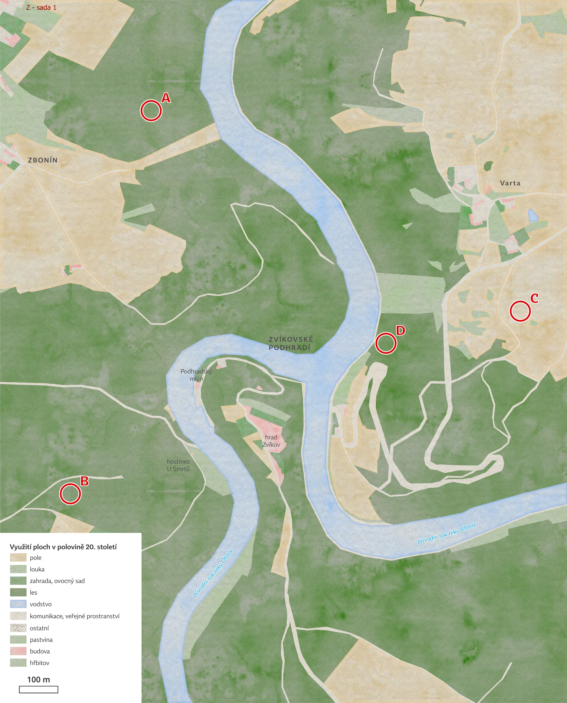
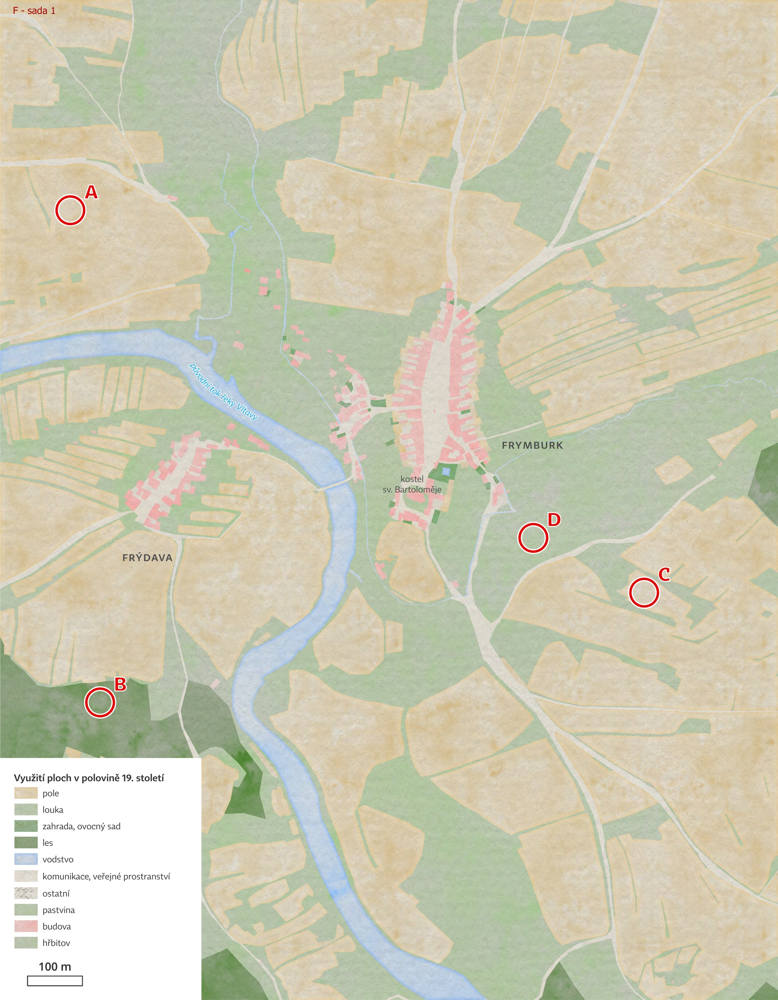

# VLTAVA – Příběh řeky na mapách a plánech (AR)

Webová aplikace rozšířené reality k atlasu **VLTAVA – Příběh řeky na mapách a plánech**. Pro zobrazení rozšířené reality stačí namířit kameru telefonu na stránku atlasu se **Zvíkovem** nebo **Frymburkem** a nad mapou se zobrazí 3D model krajiny. Modely lze přepínat mezi **19., 20. a 21. stoletím** a porovnat historický landuse se současným stavem krajiny v okolí vodních nádrží **Lipno** a **Orlík**.

## Vyzkoušet

**Odkaz na vyzkoušení:** https://frantisekmuzik.github.io/Vltava-AR-testovani/

Otevři odkaz na telefonu nebo naskenuj QR kód (testovací verze aplikace pro 2. fázi uživatelského testu):

## Jak to funguje

1. Otevři odkaz v prohlížeči na **mobilním zařízení** a povol kameru.
2. Naskenuj stránku atlasu s mapou Zvíkova nebo Frymburku. *Aplikaci lze vyzkoušet i bez papírového atlasu. Otevři aplikaci na telefonu a namiř kameru na jednu z map níže zobrazenou na druhém zařízení (počítač, tablet) nebo na jejich výtisk. Mapu na obrazovce zobraz celou, co největší a bez odlesků.*
3. Nad stránkou se zobrazí 3D model. Tlačítky dole přepínáš období (19., 20. a 21. století), tlačítko vpravo nahoře zapíná vodní nádrž (Lipno u Frymburku, Orlík u Zvíkova).
4. Legenda s měřítkem je součástí modelu.

Aplikace běží přímo v prohlížeči, neinstaluje se a nepotřebuje účet.

<table>
  <tr>
    <td align="center"> <b>Zvíkov</b></td>
    <td align="center"> <b>Frymburk</b></td>
  </tr>
</table>

## Obsah projektu

| Cesta | K čemu slouží |
| --- | --- |
| `src/.expanse.json` | scéna 8th Wall Studia (modely, image targety, tlačítka) |
| `src/tlacitka.ts` | přepínání období a hladiny vodní nádrže, tlačítka s českou diakritikou |
| `src/scan-prompt.ts` | úvodní výzva k naskenování stránky atlasu |
| `src/fonts.ts`, `src/assets/fonts/` | písmo Merriweather Sans (OFL) |
| `tools/build_water.py` | výpočet hladiny přehrady z terénu |
| `tools/split_glb.py` | rozdělení kompletních modelů na podklad a vrstvu úlohy |
| `src/assets/modely/` | 3D modely krajiny (GLB) |
| `image-targets/` | data pro rozpoznání map (image targety): tištěná mapa sady 1 – Frymburk 1. období (CO), Zvíkov 2. období (SMO5); rozpoznají se i listy sad 2–4 |
| `docs/` | mapy sady 1 ke zkušebnímu skenování a QR kód aplikace |
| `.github/workflows/deploy.yml` | automatický deploy na GitHub Pages |

## Testovací režim (2. fáze uživatelského testu)

Komponenta `test-mode` (`src/test-mode.ts`) je na kameře místo `period-switcher`. Je výhradně marker-based: úlohy se zobrazí po naskenování tištěné mapy (Zvíkov a Frymburk).

| Sada | Obsah | Modely |
| --- | --- | --- |
| 1 Změny | body A–D, tlačítky se přepíná 19., 20. a 21. století | `*_sada1_{CO,SMO5,RUIAN}.glb` |
| 2 Výška | body A–D, vrstevnice, 2 úlohy | `*_sada2_otazka{1,2}.glb` |
| 3 Zaplavení | body A–D, vrstevnice, 2 úlohy | `*_sada3_otazka{1,2}.glb` |
| 4 Vzdálenost | body A a B, 3 úlohy | `*_sada4_otazka*.glb` |

Model každé úlohy se skládá ze dvou GLB v `src/assets/test/`:

- **podklad**, který se při změně úlohy nenačítá znovu:
  - sada 1: `{Zvikov,Frymburk}_base_{CO,SMO5,RUIAN}.glb` (terén s texturou, budovy, legenda s měřítkem),
  - sady 2 a 3: `*_base_sada23.glb` (podklad SMO5 + stromy + vrstevnice s popisky, sdílený oběma sadami),
  - sada 4: `*_base_sada4.glb` (podklad CO + stromy);
- **vrstva úlohy** (`*_sada*_otazka*.glb`): u sad 2–4 jen body A–D, resp. A–B (stovky kB); u sady 1 (`*_sada1_{CO,SMO5,RUIAN}.glb`) body a stromy příslušného období.

Stromy ve sdíleném podkladu jsou jen ty, které jsou ve všech úlohách skupiny (průnik), takže žádný strom nezakrývá body žádné z úloh. Kolem bodů ostatních úloh tak mohou být drobné proluky bez stromů.

Kompletní (nerozdělené) modely jsou v repozitáři Vltava-testovani-podklady. Rozdělení zajišťuje `tools/split_glb.py`. Seznam úloh je v `src/test-tasks.ts`. Označení listů odpovídá záznamníku (např. `2-Z1` = sada 2, Zvíkov, úloha 1).

**Hladina přehrady** (tlačítko Řeka) je jedna plochá plocha ořezaná terénem. Výška: Orlík 353,00 m n. m.; Lipno u Frymburku 725,60 m n. m. (v terénu RUIAN je dno přehrady už na 724,2 m). Okraj hladiny proto vždy leží na vrstevnici hladiny a nezasahuje do svahů. Zaplavená oblast se počítá z terénu (`tools/build_water.py`), zvlášť pro historický terén (CO, SMO5) a pro současný (soubory `*_Vltava_soucasny_tok_RUIAN.glb`, aplikace je přepíná podle období).

**Terén Zvíkova a Frymburku** (CO, SMO5) je mimo hladinu přehrady (Orlík 353 m, Lipno 725,6 m) z DMR 5G, pod hladinou ze starého terénu (DMR z 50. let), na hladině se oba napojují. Vrstevnice sad 2 a 3 jsou shodné s tištěnými mapami; hladina (353 m, resp. 725,6 m) odpovídá modrému pásu „současné vodstvo“ v tisku.

**Velikost modelu** se mění stažením nebo roztažením dvěma prsty (pinch). Nastavená velikost se při změně sady, úlohy nebo období zachová.

## Vývoj

Projekt vznikl v [8th Wall Studiu](https://www.8thwall.com/).

Použité písmo: [Merriweather Sans](https://fonts.google.com/specimen/Merriweather+Sans), licence SIL OFL 1.1.

## Autor

**František Mužík**, katedra geomatiky, Fakulta stavební ČVUT v Praze.